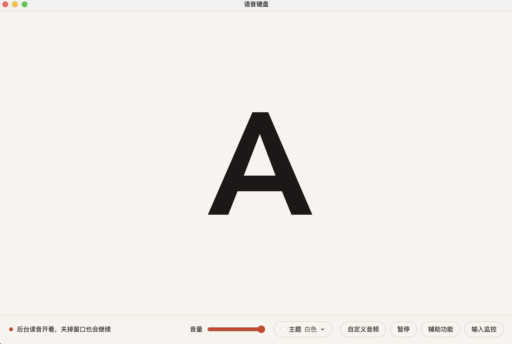
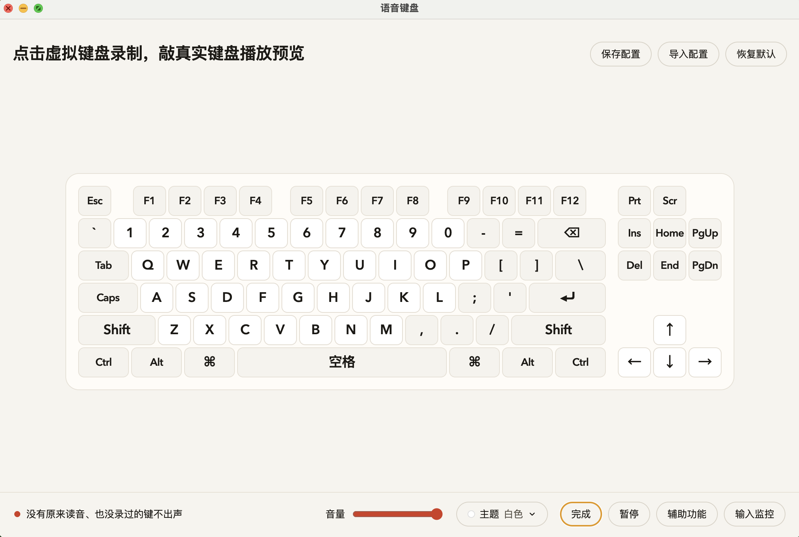
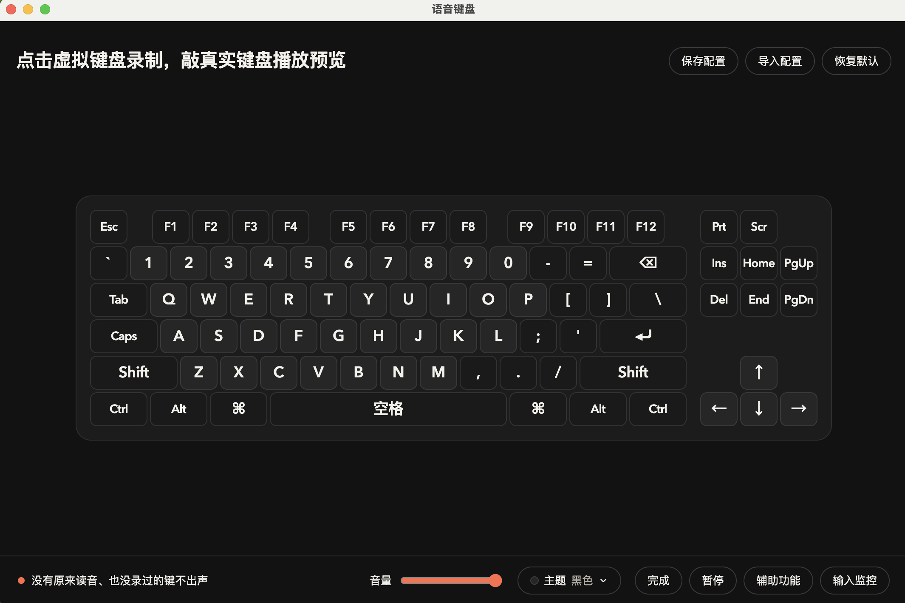

# myVoiceKeyboard

按下 A–Z、0–9 或方向键，播放对应的读音。Mac 和 Windows 都用桌面应用「语音键盘」。关掉窗口后仍会读，从菜单栏或系统托盘退出才停止。

## 直接打开

最新安装包在 GitHub Actions 的「编译安装包」运行记录里下载：Apple 芯片用 `mac-arm64` 的 dmg，Intel Mac 用 `mac-x64` 的 dmg，Windows 用 `win-x64` 的 zip。

这台电脑如果已经编过：Apple 芯片双击 `打开语音键盘.command`，或打开 `dist/mac-arm64/VoiceKeyboard.app`（访达里显示为「语音键盘」）。Intel Mac 用 `dist/VoiceKeyboard-1.0.0-mac-x64.dmg`。

第一次要在「系统设置 → 隐私与安全性」里允许「语音键盘」的辅助功能。如果按键没有声音，再到输入监控里同样允许，然后重新打开。

Windows：把 zip 解压，运行里面的 `VoiceKeyboard.exe`。若系统提示不受信任，选择仍要运行。

按键仍会输入到当前软件。密码框处于系统安全输入时不会出声。



## 换成自己的声音

打开「语音键盘」，点「自定义音频」。这里是一套键盘，不含小键盘，每个键都能录音。点虚拟键开始录，敲真实键盘播放预览。没有原来读音、也没录过的键不出声。录过的会换成你的声音，可以重录。正在录音时点「取消」会丢掉这一次，键还是刚才的声音。点「恢复」或「去掉」则清除这个键上你录的声音。录音只留在这台电脑上，最长四秒。



窗口下方的「主题」菜单可以换成黑色、白色、粉色或蓝色，下次打开还是这一套。



「保存配置」把现在的自定义录音和音量写成一个 json 文件。「导入配置」用选中的文件替换现在的自定义录音和音量。「恢复默认」清掉全部自定义录音，音量回到原来的大小，皮肤不变。

窗口里可以调音量，下次打开还是这个音量。按住 Ctrl、Alt、Option、Command 或 Win 时，别的键不读。只按 Shift 仍会读。这些修饰键自己如果录了音，按下时会读。

也可以直接替换打包进去的 wav。一个键对应一个 wav，文件名必须保持原样，扩展名也是 `.wav`。字母和数字用大写，方向键是 `LEFT.wav`、`RIGHT.wav`、`UP.wav`、`DOWN.wav`。一共 40 个：`A`–`Z`、`0`–`9`，再加上这四个方向键。内容可以是你自己念的「A」「左」或其他短句。用「语音备忘录」或系统录音机录好后，导出或另存为 wav。如果手里是 m4a、mp3，先转成 wav 再替换。

已经装好的应用，先从菜单栏或系统托盘里退出，再换文件，然后重新打开。只关窗口不够，程序还在，用的仍是刚才读进内存的声音。

- Mac：在访达里右键「语音键盘」→「显示包内容」→ `Contents/Resources/audios/`，用同名 wav 覆盖。
- Windows：在 `VoiceKeyboard.exe` 旁边的 `resources/audios/` 里覆盖。

从源码改：替换 `keyboard/audios/` 里的同名文件。网页演示会直接用新文件。桌面应用要重新打包后才会带上新声音：

```bash
cd app
npm run build:mac
npm run build:win
```

## 开发

```bash
cd app
npm install
npm start
```

打包：

```bash
npm run build:mac
npm run build:win
```

产物在 `dist/`。推送到 GitHub 的 main 后，Actions 里的「编译安装包」会编出同样的 Mac 和 Windows 包，在该次运行记录里下载。不从本机把安装包传上去。

## 前台网页

用浏览器打开 `keyboard/index.html`。页面在前台时，按 A–Z、0–9 或方向键，会把这个键放大显示并播放对应的 wav。按住 Ctrl、Alt、Option、Command 或 Win 时不出声。只按 Shift 仍会读。

网页只有这 40 个键，不录音，不调音量，也没有完整键盘。切到别的软件后，这个页面就听不到按键。日常使用请打开桌面应用。
